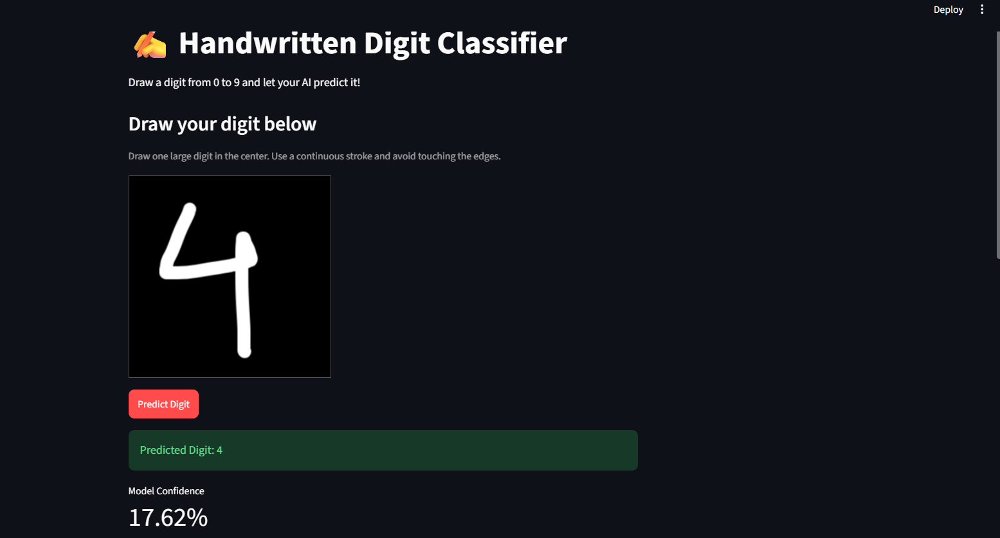
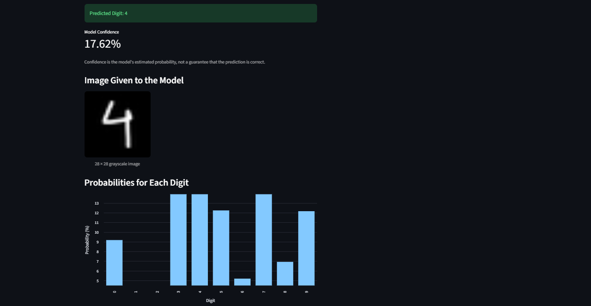

# ✍️ MNIST Handwritten Digit Classifier
A handwritten digit recognition system built using Python, NumPy, and a neural network with an interactive Streamlit application.

## 📖 Overview
The project uses a neural network implemented with NumPy to recognize handwritten digits from 0 to 9. Users can draw digits in the Streamlit application and view predictions.

## 🖥️ App Review
✨ App Features

- ✍️ Draw digits from 0 to 9.
- 🖼️ Automatic image preprocessing.
- 🔢 Predict the handwritten digit.
- 📊 View the model's estimated confidence.
- 📈 Visualize probabilities for all ten digits.

### Application Preview : -



## 🎯 Problem Statement
To develop a neural network that can accurately identify handwritten digits despite variations in handwriting styles.

## 📂 Dataset
- Dataset: MNIST Handwritten Digits
- Total images: 70,000
- Training images: 60,000
- Testing images: 10,000
- Image size: 28 × 28 pixels
- Classes: 0–9

## 🛠️ Tools and Technologies
- Python
- NumPy
- Matplotlib
- Streamlit
- Pillow
- Jupyter Notebook

## ⚙️ Methods
1. Data loading and preprocessing
2. Pixel normalization
3. Image flattening
4. Neural network implementation
5. Forward propagation and backpropagation
6. Model training and evaluation
7. Streamlit application development

## 🔍 Key Insights
- Image preprocessing affects prediction quality.
- Handwriting variations can cause misclassification.
- Test accuracy may differ from predictions on custom drawings.

## 📊  Model / Output
The application displays the predicted digit, estimated confidence, processed image, and probabilities for all ten digits.

### Prediction Results :- 


## ▶️ How to Run This Project?
```bash
python -m pip install -r requirements.txt
python -m streamlit run app.py
```

## 🏆 Results & Conclusion
The model has previously achieved approximately 78% test accuracy. Update this value using the final evaluation result.

The project demonstrates neural network implementation, image preprocessing, and interactive digit recognition.


## 👩‍💻 Author & Contact
**Ashna Ansari**

- GitHub: https://github.com/ashnaansari
- LinkedIn: https://www.linkedin.com/in/ashna-ansari
- Email: ashnaansari87@gmail.com

⭐ If you like this project, give it a star on GitHub!